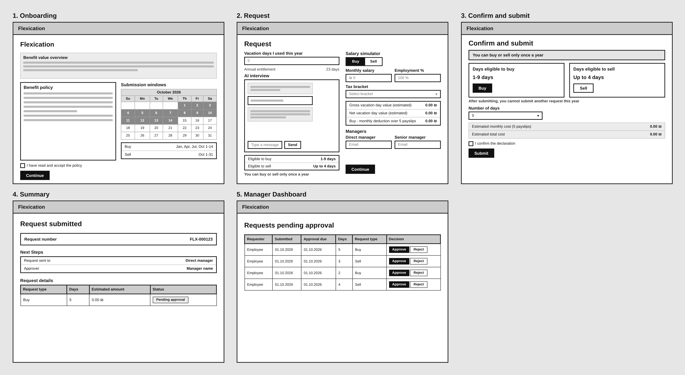
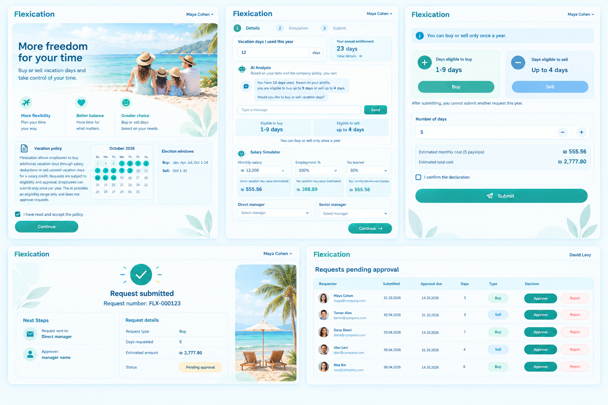
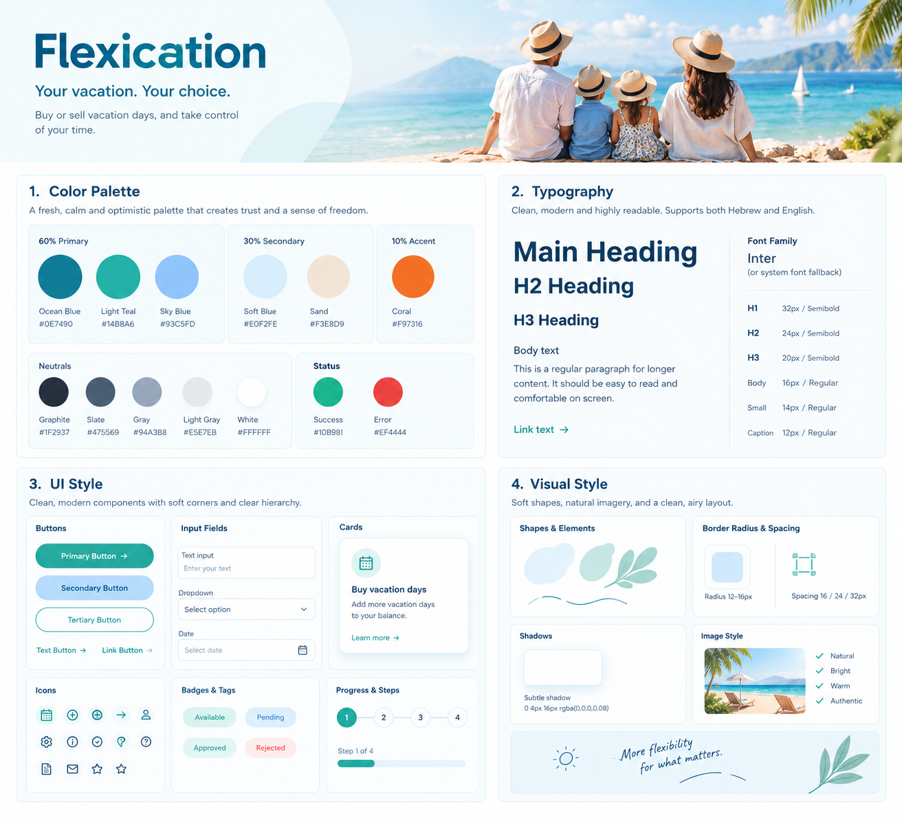

# DESIGN: Flexication

מסמך עיצוב. נבנה מ-`product-10-definitions.md` ו-`PRD.md`, ומשלוש התמונות: `wireframes.png`, `mockups.png` ו-`style-guide.png`.
תאריך: 17.10.2026. סטטוס: טיוטה לאישור.

המוצר באנגלית ובכיוון משמאל לימין (LTR), במחשב בלבד. הטקסטים שבממשק מצוטטים באנגלית כפי שהם מופיעים בתמונות.
כשהתמונות והמסמכים נבדלים זה מזה, המסמך הזה נשען על ה-PRD ועל `wireframes.png` לתוכן ולהתנהגות, ועל `mockups.png` ו-`style-guide.png` למראה. הפערים רשומים בסוף המסמך, בסעיף "פערים ידועים".

## תמונות הייחוס

## 1. Screens

חמשת המסכים והשמות שלהם זהים לאלה שב-PRD (סעיף "המסכים"). לצד כל שם מופיע שמו באנגלית כפי שמופיע בתמונות.

**כותרת (בכל המסכים).** שם המוצר "Flexication" בצד שמאל, ושם המשתמש המחובר בצד ימין (למשל "Maya Cohen" לעובד, "David Levy" למנהל). שם המשתמש בכותרת אינו מופיע ב-PRD, ראו "פערים ידועים".

### 1. Onboarding
- **המטרה:** להציג לעובד מה ההטבה נותנת, לתת לו לקרוא את המדיניות ולאשר אותה, ולהראות מתי אפשר להגיש בקשה.
- **מה יש במסך:**
  - הסבר קצר על ערך ההטבה (ב-`mockups.png`: תמונה ראשית והכותרת "More freedom for your time", עם שלושה יתרונות: More flexibility, Better balance, Greater choice). דף הנחיתה השיווקי הוא Could ב-PRD.
  - נוסח מדיניות ההטבה, מוצג על המסך.
  - לוח שנה של אוקטובר 2026 עם ימי חלון ההגשה מסומנים (1-14). הלוח הוא Should ב-PRD.
  - טבלת חלונות הגשה: Buy: Jan, Apr, Jul, Oct 1-14. Sell: Oct 1-31.
  - תיבת סימון "I have read and accept the policy".
  - כפתור "Continue".
- **מה קורה במסך:** העובד קורא את המדיניות ומסמן שקרא (פעולה מפורשת, FR-04). רק אחרי הסימון הוא ממשיך. לחיצה על "Continue" מעבירה למסך 2 (Request).

### 2. בקשה (Request)
- **המטרה:** לאסוף מהעובד את הנתונים לבקשה, להציג לו כמה ימים הוא זכאי לקנות או למכור, ולתת לו הערכת עלות לפני השליחה.
- **מה יש במסך:**
  - שדה "Vacation days I used this year" (מספר שלם, לא שלילי, לא גדול מהזכאות השנתית), ומתחתיו "Annual entitlement" (ב-wireframes: 23 days). הזכאות מגיעה ממאגר העובדים.
  - "AI interview": שיחה עם ה-AI, שדה "Type a message" וכפתור "Send".
  - תוצאת הזכאות: "Eligible to buy: 1-9 days" ו-"Eligible to sell: up to 4 days".
  - הודעה קבועה: "You can buy or sell only once a year".
  - "Salary simulator": בורר Buy / Sell, שדות Monthly salary, Employment % ו-Tax bracket, ותוצאות: "Gross vacation day value (estimated)", "Net vacation day value (estimated)" ו-"Buy - monthly deduction over 5 payslips".
  - "Managers": שדות Direct manager ו-Senior manager.
  - כפתור "Continue".
- **מה קורה במסך:**
  - ה-AI מראיין את העובד ומסביר את התוצאה. מספר הימים הזכאים מחושב בקוד, ולא על ידי ה-AI.
  - הסימולטור מתעדכן עם כל נתון שהעובד מזין. בקנייה העלות מחולקת ל-5 תלושים. במכירה הזיכוי מוצג בתלוש דצמבר ואינו נפרס (PRD, FR-07).
  - מנהל בכיר הוא גיבוי בלבד, והאישור חד-שלבי.
  - "Continue" מעביר למסך 3 (Confirm and submit).

### 3. אישור וביצוע (Confirm and submit)
- **המטרה:** לתת לעובד לבחור פעולה וכמות, לראות את העלות לפני השליחה, ולשלוח את הבקשה.
- **מה יש במסך:**
  - מסגרת בולטת בראש המסך: "You can buy or sell only once a year".
  - שני כרטיסים: "Days eligible to buy: 1-9 days" עם כפתור "Buy", ו-"Days eligible to sell: up to 4 days" עם כפתור "Sell".
  - טקסט קטן: "After submitting, you cannot submit another request this year".
  - שדה "Number of days".
  - סיכום: "Estimated monthly cost (5 payslips)" ו-"Estimated total cost".
  - תיבת סימון "I confirm the declaration" וכפתור "Submit".
- **מה קורה במסך:**
  - לכל סוג פעולה כפתור נפרד. פעולה שאין זכאות אליה חסומה (FR-01).
  - העובד בוחר כמות רק בתוך הטווח הזכאי.
  - הסיכום מתעדכן עם הכמות שנבחרה. כל הסכומים מסומנים כמשוערים.
  - "Submit" לא פעיל עד שתיבת ההצהרה מסומנת.
  - שליחה מחוץ לחלון הגשה פתוח, או בקשה נוספת באותה שנה, נחסמת עם הודעה ברורה (FR-02, FR-03).
  - "Submit" מעביר למסך 4 (Summary).

### 4. מסכם (Summary)
- **המטרה:** לאשר לעובד שהבקשה נשלחה, ולהראות מה קורה אחר כך.
- **מה יש במסך:**
  - "Request submitted" ו-"Request number" (ב-wireframes: FLX-000123).
  - "Next Steps": "Request sent to: Direct manager", "Approver: manager name". אין מועד צפוי לתשובה (הוחלט ב-17.10.2026).
  - "Request details": Request type, Days, "Estimated amount", ו-Status ("Pending approval").
- **מה קורה במסך:**
  - המסך מוצג מיד אחרי השליחה.
  - כשהעובד חוזר לכלי אחרי Submit, מוצגים לו פרטי הבקשה והסטטוס הנוכחי שלה (Should ב-PRD, FR-12).
  - אין כפתור בתחתית המסך, והמסך אינו מוביל למסך אחר.

### 5. Dashboard מנהל (Manager Dashboard)
- **המטרה:** לתת למנהל מקום אחד לראות את הבקשות שממתינות לאישורו ולהחליט.
- **מה יש במסך:** הכותרת "Requests pending approval", וטבלה עם העמודות Requester, Submitted, Approval due, Days, Request type (Buy או Sell) ו-Decision, עם כפתורים "Approve" ו-"Reject" בכל שורה.
- **מה קורה במסך:**
  - המסך מוצג בכל כניסה של מנהל לכלי, והוא מציג רק בקשות שממתינות לאישורו.
  - "Approval due" הוא תאריך סיום חלון ההגשה.
  - "Approve" או "Reject" מעדכנים את הבקשה והעובד מקבל מייל. העדכון מותנה: אם הבקשה כבר הוכרעה או שהחלון הסתיים, מוצגת הודעה (ARCHITECTURE, סעיף 6).

### ניווט בין המסכים
- **עובד:** 1 Onboarding ← 2 Request ← 3 Confirm and submit ← 4 Summary, בסדר ליניארי, בכפתורי "Continue" ו-"Submit". בתמונות אין כפתורי חזרה בין המסכים. כשהעובד חוזר אחרי Submit הוא רואה את מסך 4.
- **מנהל:** בכניסה מגיע למסך 5.
- מסך כניסה (Sign in) מוזכר ב-ARCHITECTURE אך אינו מופיע בתמונות.

## 2. Style Guide

המקור: `style-guide.png`. כל מקום שבו הערך נקבע בהחלטה אחרת, מצוין. הערכים הרשומים כ"נמדד" נמדדו בדגימת פיקסלים מהתמונה, והם משוערים.

### צבעים

| תפקיד | שם | HEX |
|---|---|---|
| Primary (60%) | Ocean Blue | #0E7490 |
| Primary (60%) | Light Teal | #14B8A6 |
| Primary (60%) | Sky Blue | #93C5FD |
| Secondary (30%) | Soft Blue | #E0F2FE |
| Secondary (30%) | Sand | #F3E8D9 |
| Accent (10%) | Coral | #F97316 |
| Neutral | Graphite | #1F2937 |
| Neutral | Slate | #475569 |
| Neutral | Gray | #94A3B8 |
| Neutral | Light Gray | #E5E7EB |
| Neutral | White | #FFFFFF |
| Status | Success | #10B981 |
| Status | Error | #EF4444 |

צבעים שמופיעים במסכים ולא ב-Style Guide (נמדד, משוער):
- כחול כהה לכותרות ולשם המוצר, בערך #0C3C64.
- כחול כפתור Sell, בערך #7BBFF6 במסכים (ובערך #48A8E0 בגרסה הקודמת של התמונה).

### גופנים
- **גופן:** Heebo (Google Fonts), עם גופן מערכת כגיבוי. זו החלטה של בעלת המוצר מ-17.10.2026, בהתאם ל-`tech-stack.md` ול-`ARCHITECTURE.md`. התמונה `style-guide.png` עדיין מציגה Inter, ראו "פערים ידועים".
- **גדלים (מ-`style-guide.png`):**

| רמה | גודל ומשקל |
|---|---|
| H1 | 32px, Semibold |
| H2 | 24px, Semibold |
| H3 | 20px, Semibold |
| Body | 16px, Regular |
| Small | 14px, Regular |
| Caption | 12px, Regular |

- קישורים: טקסט בצבע ירקרק-כחול עם חץ ("Link text →").

### כפתורים ורכיבים
- **Primary Button:** כפתור מלא בצבע ירקרק-כחול (גרדיאנט עדין), טקסט לבן, פינות עגולות לגמרי, ולעיתים חץ. משמש ל-"Continue", "Submit" ו-"Approve".
- **Secondary Button:** כפתור מלא בכחול בהיר. משמש ל-"Sell".
- **Tertiary Button:** כפתור עם מסגרת בלבד.
- **Text Button / Link Button:** טקסט עם חץ.
- **שדות קלט:** שדה טקסט עם מסגרת דקה ו-placeholder, רשימה נפתחת עם חץ, ושדה תאריך עם אייקון לוח שנה.
- **כרטיסים:** רקע לבן, פינות מעוגלות, צל עדין, אייקון בעיגול בהיר, כותרת, טקסט וקישור.
- **אייקונים:** אייקוני קו בעיגולים בגוון ירקרק בהיר (לוח שנה, פלוס, חץ, משתמש, הגדרות, מידע, וי, מסמך, מייל).
- **תגיות סטטוס (Badges):** Available (ירוק בהיר), Pending (כחול בהיר), Approved (ירוק), Rejected (אדום בהיר). בדשבורד המנהל, "Buy" ו-"Sell" מוצגות כתגיות באותו סגנון.
- **Progress & Steps:** מופיע ב-`style-guide.png` אבל הממשק לא כולל Stepper (ראו "פערים ידועים").

### פינות, צורות ומרווחים
- רדיוס פינות: 12-16px.
- מרווחים: 16 / 24 / 32px.
- צל עדין: `0 4px 16px rgba(0,0,0,0.08)`.
- צורות אורגניות רכות (כתמי צבע, עלים וקווים מעוגלים) כרקע ולקישוט.

### אווירה כללית
- אווירת חופשה: ים, חוף ומשפחה, בצבעי כחול וטורקיז רכים עם רקע בהיר ומרווח.
- סגנון תמונות: Natural, Bright, Warm, Authentic.
- מסר: "Your vacation. Your choice." ו-"More flexibility for what matters."
- הרגשה כללית: רגועה, אופטימית ובוטחת, עם היררכיה ברורה.

## פערים ידועים

הפערים נמצאו בבדיקה של התמונות מול ה-PRD ביום 17.10.2026. הבנייה נשענת על ה-PRD ועל `wireframes.png` ככל שהם נבדלים מהתמונות האחרות.

1. **`style-guide.png` לא עודכן:** הוא עדיין מציג Inter במקום Heebo, את הכיתוב "Supports both Hebrew and English", את Coral בלי רכיב שמשתמש בו, את הקטע Progress & Steps, ואינו כולל את הכחול הכהה ואת כחול ה-Sell שמופיעים במסכים.
2. **ניגודיות הכפתורים:** ב-`mockups.png`, טקסט לבן על כפתורי ה-Teal מגיע לכ-2.6 עד 2.9, ועל כפתור Sell לכ-2.0 (נמדד, משוער). ה-PRD דורש ניגודיות שעוברת את התקן (4.5:1 לטקסט רגיל). לפי ערכי ה-HEX שבפלטה:
   - טקסט לבן על Ocean Blue (#0E7490): 5.36:1.
   - טקסט לבן על Light Teal (#14B8A6): 2.49:1, ולכן אינו עומד בדרישה.
   - טקסט Graphite (#1F2937) על Light Teal: 5.90:1.
   - טקסט Graphite על Sky Blue (#93C5FD): 8.14:1.
   - **המלצה (לא הוחלט):** כפתורים בצבע Ocean Blue עם טקסט לבן, או טקסט כהה על Light Teal ועל Sky Blue. גם קישורים בצבע Light Teal על רקע לבן אינם עומדים בדרישה (2.49:1).
3. **Stepper במסך 2:** `mockups.png` מציג Stepper ("Details, Simulation, Submit"), שאינו ב-PRD ולא ב-wireframes. הוא אינו חלק מהעיצוב.
4. **שדות המנהלים:** `mockups.png` מציג רשימה נפתחת "Select manager". לפי ה-PRD (FR-08) וה-wireframes, העובד מזין את כתובות האימייל של המנהלים, ואין מאגר מנהלים.
5. **תאריכי הגשה במסך 5:** `mockups.png` מציג תאריכי הגשה בחודש אפריל (02.04.2026 עד 06.04.2026) לצד תאריכי יעד באוקטובר. תאריך ההגשה חייב להיות בתוך חלון ההגשה.
6. **שם משתמש בכותרת:** מופיע ב-`mockups.png` ובו תפריט (חץ) שלא התבקש, ואינו מופיע ב-PRD ולא ב-wireframes. בעלת המוצר ביקשה להשאיר את שם המשתמש. אם הוא נדרש כדרישה, יש להוסיפו ל-PRD.
7. **שם חלונות ההגשה:** ב-`mockups.png` הכותרת היא "Election windows", וב-wireframes "Submission windows". יש לבחור שם אחד.
8. **נוסח "פעם אחת בשנה":** הטקסט "After submitting, you cannot submit another request this year" מדויק רק לבקשה ממתינה או מאושרת. לפי FR-02, בקשה שנדחתה או שנסגרה ללא החלטה אינה נספרת.
9. **מסך כניסה:** מופיע ב-`ARCHITECTURE.md` אבל לא בתמונות וב-PRD. אין לו עיצוב.
